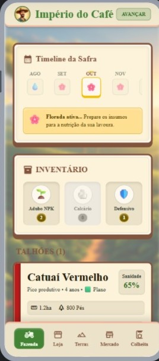

# Império do Café — Zona da Mata

[English](README.md) · **Português**

Simulador de cafeicultura mineira para celular no estilo "Brasfoot do café": gestão por menus e telas, sem gráficos 3D. Do aperto de uma rocinha pequena a um império de fazendas certificadas.

> **Tipo:** projeto pessoal — jogo mobile em desenvolvimento (ainda não publicado nas lojas). Feito com React Native + Expo; save local no AsyncStorage, jogo 100% offline.

<p align="center">
  
</p>

## O que é

Você é um cafeicultor da Zona da Mata de Minas Gerais. Começa com 1 talhão pequeno (rocinha pronta) ou terra nua e precisa transformar isso numa fazenda lucrativa ao longo de muitas safras.

**Loop central:** plantar → conduzir → colher → processar → vender → reinvestir → expandir. Lavoura nova leva cerca de 3 anos para formar e produzir.

## Sistemas implementados

### Ciclo agronômico
- **11 variedades** com traços próprios (Catuaí, Bourbon Amarelo/Vermelho, Topázio, Acaiá, Paraíso MGS 2, Arara, Catucaí, Conilon...)
- **3 densidades de plantio** (tradicional, adensado, super-adensado) e sol pleno vs. sombreado
- **Florada-veranico**, **granação** dependente da chuva de jan–mar, **bienalidade** e curva idade-produtiva

### Manejo
- Adubo, calcário (efeito atrasado) e defensivo
- Esqueletamento e recepa; irrigação por talhão
- Mensalistas + encarregado

### Pragas e doenças
- **6 pragas** com sazonalidade (bicho-mineiro, broca, ferrugem, cigarrinha, cercospora, mancha-de-phoma)
- Amostragem revela a praga ativa; variedades resistentes reduzem a ferrugem

### Pós-colheita
- **3 métodos**: Natural, Cereja Descascado (CD) e Lavado; lavador-sifão separa cereja de boia
- **Secagem dia a dia** com clima sorteado por seed; secador mecânico ignora chuva

### Mercado e economia
- Classificação **Tipo BRASIL × Peneira × SCA**; microlote quando SCA ≥ 85
- Índice de mercado diário e **7 eventos macro**
- **Leilão de cafés especiais**, **3 certificações** (Rainforest, Fair Trade, Orgânico), cooperativa e financiamento Funcafé
- Tulha com capacidade limitada (50/150/500 sacas), **7 equipamentos** e **10 propriedades** à venda

### Eventos extremos
- Geada negra, granizo e seca crítica

### Progressão e UX
- **Tutorial** em 7 passos, **glossário** com 49 termos, dashboard com receita × despesa
- **23 marcos** em 9 categorias, **12 missões**, **5 níveis** com desbloqueios, festas regionais e cursos de ATER
- HUD com alertas e próximo evento, timeline dos 12 meses, histórico de eventos com filtros
- Música do menu com opção de ligar/desligar música e efeitos em **Configurações**

## Stack

| | |
|---|---|
| Framework | Expo SDK 54 (`expo ~54.0.0`) |
| UI | React Native 0.81.5 / React 19.1.0 |
| Estado | `useReducer` + Context |
| Persistência | `@react-native-async-storage/async-storage` |
| Áudio | `expo-audio` |
| RNG | mulberry32 seedável |
| Linguagem | JavaScript |
| Plataformas | iOS + Android (via Expo Go ou build EAS) |

Sem bibliotecas de UI externas — tudo em componentes do React Native.

## Como rodar

### Pré-requisitos
- Node.js **20.19.4 ou superior** (exigido pelo React Native 0.81 / Metro)
- Expo Go no celular (iOS/Android), com PC e celular na mesma rede

### Setup
```bash
git clone https://github.com/rickjs2005/rpg-mobile
cd rpg-mobile
npm ci
npx expo start --lan
```

Escaneie o QR code com o Expo Go (no iOS, a câmera nativa funciona).

Não há variáveis de ambiente.

### Scripts disponíveis
| Comando | O que faz |
|---|---|
| `npm start` | `expo start` |
| `npm run android` | `expo start --android` |
| `npm run ios` | `expo start --ios` |
| `npm run web` | `expo start --web` (exige instalar `react-dom` e `react-native-web`, que não estão no projeto) |

Verificação do bundle JS sem build nativo: `npx expo export --platform android`.

Builds de loja usam EAS (`eas.json` com perfis `development`, `preview` e `production`); o roteiro está em [docs/LANCAMENTO.md](docs/LANCAMENTO.md).

## Estrutura

```
App.js              shell: SafeArea + HUD + telas + menu inferior
src/
├── data/           dados puros (variedades, economia, clima, pragas, mercado, marcos, glossário, tutorial...)
├── logic/          funções puras de simulação (sem React)
├── hooks/          reducer, Context (useJogo) e save
├── components/     telas e cards (Pressable, View, Text)
├── audio/          motor de áudio e registro de sons
├── state/          estatísticas globais
└── styles/tema.js  paleta e constantes visuais
assets/             ícones, splash, ilustrações e música do menu
docs/               documentação do jogo, checklist de lançamento e referências visuais (ref-*.html/png)
```

Regra central: nenhum componente tem lógica de simulação e nenhum módulo de `logic/` importa React.

## Save

Salvamento automático no AsyncStorage do dispositivo, com múltiplos slots de fazenda (chaves `imperio-cafe-save-v1-slot{n}`; um save antigo de chave única é migrado para o slot 0). Para começar de novo, apague a fazenda na tela de início.

## Limitações

- Não há testes automatizados, lint nem typecheck configurados.
- Ainda não publicado nas lojas; pendências de lançamento estão em [docs/LANCAMENTO.md](docs/LANCAMENTO.md).
- A maioria dos efeitos sonoros ainda não existe (o motor ignora sons ausentes); só a música do menu está incluída.
- O balanceamento da economia ainda está sendo calibrado.

## Créditos e mídias

- **Música do menu** (`assets/audio/menu.mp3`): "Echoes Beyond Horizons", da StockTune. Os termos de licença ainda precisam ser confirmados pelo autor (ver [assets/audio/README.md](assets/audio/README.md)).
- **Logo, mascote e ilustrações** em `assets/`: gerados com IA segundo o checklist de lançamento; o direito de uso comercial ainda precisa ser confirmado.
- Nomes reais (Cocatrel, Funcafé, DJI Agras, Rainforest Alliance, Fair Trade, Cup of Excellence etc.) aparecem só como referência temática; o jogo não tem vínculo com essas empresas ou instituições.
- Inspirações: Brasfoot, Stardew Valley, Farming Simulator e a cafeicultura real da Zona da Mata.

## Contribuição

Veja [CONTRIBUTING.md](CONTRIBUTING.md).

## Segurança

Veja [SECURITY.md](SECURITY.md).

## Licença

O repositório contém um arquivo [LICENSE](LICENSE) com o texto da licença MIT; a linha de copyright dele (650 Industries, Inc., aka Expo) veio do template do Expo. As mídias de terceiros listadas em "Créditos e mídias" seguem os termos das respectivas fontes.
